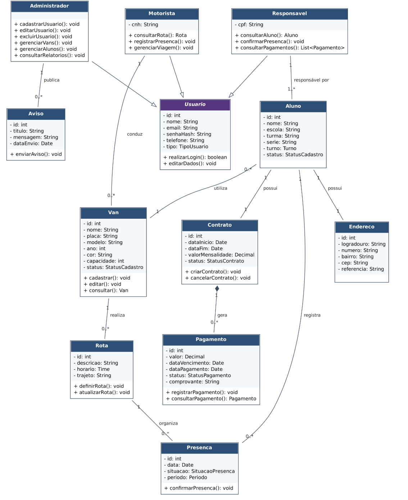

# Diagrama de Classes — Projeto Van Escolar

## 1. Sobre o projeto

O Projeto Van Escolar tem como objetivo desenvolver um sistema para auxiliar no gerenciamento de uma empresa de transporte escolar, centralizando informações de alunos, responsáveis, motoristas, veículos e pagamentos.

O diagrama de classes representa a estrutura do sistema, demonstrando suas principais entidades, atributos, métodos e relacionamentos.

## 2. Diagrama de Classes

## 3. Descrição das Classes

| Classe | Descrição |
|---|---|
| **Usuario** | Classe principal que armazena os dados de acesso, como nome, e-mail, senha e telefone. |
| **Administrador** | Responsável pelo gerenciamento dos usuários, vans, alunos, relatórios e avisos. |
| **Motorista** | Responsável pela condução da van, consulta de rotas, registro de presenças e gerenciamento de viagens. |
| **Responsavel** | Representa os pais ou responsáveis pelos alunos, permitindo consultar informações, confirmar presenças e acompanhar pagamentos. |
| **Aluno** | Armazena os dados dos estudantes transportados, incluindo escola, turma, série, turno e situação cadastral. |
| **Van** | Representa os veículos utilizados no transporte escolar, armazenando placa, modelo, capacidade e demais informações. |
| **Endereco** | Armazena os dados de localização do aluno, como logradouro, número, bairro, CEP e referência. |
| **Contrato** | Representa o vínculo entre o aluno e o serviço de transporte, contendo datas, mensalidade e situação contratual. |
| **Pagamento** | Controla os pagamentos das mensalidades, incluindo valores, vencimentos, datas de pagamento e comprovantes. |
| **Presenca** | Registra a situação de utilização do transporte pelo aluno em determinada data e período. |
| **Rota** | Representa os trajetos realizados pelas vans, incluindo descrição, horário e trajeto. |
| **Aviso** | Permite o envio de comunicados e informações aos responsáveis. |

## 4. Relacionamentos entre as Classes

O sistema possui os seguintes relacionamentos:

- **Herança:** Administrador, Motorista e Responsável herdam os atributos e métodos da classe Usuario.
- **Administrador e Aviso:** um administrador pode publicar diversos avisos.
- **Motorista e Van:** um motorista pode conduzir diferentes vans ao longo do sistema, enquanto cada van possui um motorista responsável.
- **Responsável e Aluno:** um responsável pode estar vinculado a um ou mais alunos.
- **Aluno e Van:** cada aluno utiliza uma van, que pode transportar diversos alunos.
- **Aluno e Endereço:** cada aluno possui um endereço cadastrado.
- **Aluno e Contrato:** cada aluno possui um contrato relacionado ao serviço de transporte.
- **Contrato e Pagamento:** um contrato pode gerar diversos pagamentos referentes às mensalidades.
- **Aluno e Presença:** cada aluno possui um histórico de registros de presença.
- **Van e Rota:** uma van pode realizar diferentes rotas.
- **Rota e Presença:** uma rota organiza os registros de presença dos alunos.

## 5. Organização e Regras do Sistema

O modelo foi estruturado para separar as responsabilidades de cada parte do sistema, facilitando a manutenção e a implementação das funcionalidades.

Os principais pontos considerados são:

- Controle de acesso por diferentes tipos de usuários.
- Gerenciamento de alunos e seus respectivos responsáveis.
- Associação dos alunos às vans cadastradas.
- Controle de contratos e mensalidades.
- Registro e consulta de presenças.
- Organização das rotas de transporte escolar.
- Comunicação entre administrador e responsáveis por meio de avisos.

## 6. Considerações Finais

O diagrama de classes apresenta uma visão estrutural do Projeto Van Escolar, servindo como referência para o desenvolvimento do sistema.

Sua organização permite compreender como as informações serão armazenadas e como as diferentes partes do sistema se relacionam, servindo de base para a implementação e futuras
